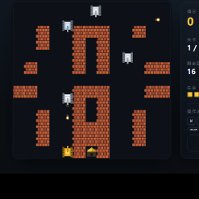

# 坦克大战 · Tank Battle

一个用原生 HTML + Canvas 写的坦克大战游戏。**零依赖、无需构建、单机可玩**，双击 `index.html` 就能开始，也可以直接部署到 GitHub Pages。



## 玩法

守住左下角的基地 🏠，消灭全部敌方坦克。

| 按键 | 功能 |
| --- | --- |
| `W` `A` `S` `D` / 方向键 | 移动 |
| `空格` / `J` / `K` | 开火 |
| `P` / `Esc` | 暂停 |
| `R` | 重新开始 |
| `M` | 音效开关 |

手机 / 平板会自动显示屏幕虚拟方向键与开火按钮。

## 特性

- **5 张关卡地图**：砖墙、钢墙、水面、草丛四种地形，草丛会遮挡视线
- **4 种敌方坦克**：普通兵、快速兵、精英兵、重甲兵（3 点血，带血条）
- **AI 会追你**：困难模式下敌人会主动朝玩家与基地靠拢，并沿轴向瞄准开火
- **6 种道具**：火力升级 ★、全屏爆破 ✹、无敌护盾 ◆、基地强化 ▤、额外生命 ♥、敌军冻结 ⌛
- **基地护墙机制**：开局基地三面砖墙，第一次被击中只是破墙，第二次才会沦陷
- **三档难度 / 三种初始生命**，可选
- **程序化音效**：用 Web Audio 实时合成，不依赖任何音频素材
- **自适应布局**：高 DPI 屏幕清晰渲染，移动端自动缩放

## 目录结构

```
tank-battle/
├── index.html        # 页面骨架、菜单、HUD
├── css/style.css     # 全部样式
├── js/game.js        # 游戏全部逻辑（约 1600 行）
└── README.md
```

`js/game.js` 内部按注释分块：

1. 常量与配置
2. 工具函数
3. 地形与地图
4. 音效（WebAudio 合成）
5. 实体：Tank / Player / Enemy / Bullet / PowerUp / Explosion
6. 关卡数据
7. 游戏主循环与状态机
8. 输入（键盘 / 触屏）
9. 渲染与 HUD

## 本地运行

直接双击 `index.html` 即可。若想用本地服务器：

```bash
# Python
python -m http.server 8000

# Node.js
npx serve .
```

## 自定义关卡

地图是 13×13 的字符矩阵，在 `js/game.js` 的 `STAGES` 数组里改就行：

| 字符 | 含义 |
| --- | --- |
| `.` | 空地 |
| `B` | 砖墙（可打碎） |
| `S` | 钢墙（强化弹才能打碎） |
| `W` | 水面（坦克不能过，子弹可过） |
| `T` | 草丛（坦克可过，遮挡视线） |

最后一排会由程序清空以保证通行，基地固定在 (6, 12)。

## 部署到 GitHub Pages

仓库 **Settings → Pages**，Source 选 `Deploy from a branch`，分支选 `main`、目录选 `/ (root)`，保存后等一两分钟即可通过 `https://<用户名>.github.io/tank-battle/` 访问。

> 私有仓库的 Pages 需要 GitHub Pro 等付费方案；公开仓库免费。

## License

MIT
